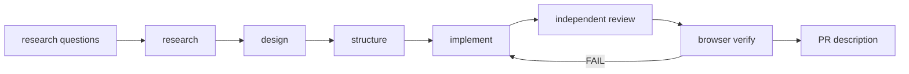

# Brought AI coding agents into the SDLC, with gated stages, browser-verified changes and 2 PRs merged upstream

**Live:** [e2e-inc/e2e PR #1979](https://github.com/e2e-inc/e2e/pull/1979) and [PR #1982](https://github.com/e2e-inc/e2e/pull/1982) · **Code:** pi-rpi-workflow [ask: link the pi-rpi-workflow repo here once its README is scrubbed of employer-internal URLs] · **Skills proven:** AI-assisted SDLC, AI agents, End-to-end testing, TypeScript, Open source, Mutation testing

## The story

### Context

Coding agents write code fast, but a team can only trust what it can check. My work here had three parts. I ran a team workshop and turned the team's pain points into agent skills [ask: when, for which team, how many people, and which pain points became which skills]. I made ADRs the team's memory [ask: how many ADRs, and how the team uses them]. And I made end-to-end verification part of every change, which led to two PRs to the e2e testing framework that the agents verify with.

### My role and constraints

[ask: your role in the rollout, and who else was involved]. I wrote pi-rpi-workflow and the verification skills, and authored both upstream PRs. Constraints:

- Agents may not merge on their own; a human approves each stage and pushes.
- Upstream changes had to fit the framework's existing contracts and pass review by its maintainers.

### Key decisions

1. **Gate every stage on a human (pi-rpi-workflow).** The pipeline has 8 stages: research questions, research, design, structure, implementation, review, verify and PR description. Each stage is one subagent that writes an artifact and stops for human approval. It works in an isolated worktree, and a human pushes.
2. **Review with a different model than the one that built it.** The review stage runs on a different model from the one that designed and implemented the change.
3. **Verify in a real browser before the PR.** The verify stage checks the change in a browser and reports PASS, FAIL or INCOMPLETE. A FAIL loops back to implementation.
4. **Add missing APIs upstream instead of working around them.** Under the framework's umbrella issue for missing APIs, I claimed two items and opened one PR for each. `tap({ count })` follows the maintainers' rule of a new action kind rather than a new field. An engine without it now fails with `UNSUPPORTED_CAPABILITY` before lookup, instead of quietly tapping once. `test.slow()` triples the timeout in force, as in Playwright, by building on the framework's published timeout setter.

### What went wrong

I couldn't run the mobile path of `tap({ count })` locally, because I had no Xcode or Android SDK. It passed in CI on both the iOS simulator and the Android emulator. After the merge I noticed that my own device test, `toContainText('3 taps')`, would also accept `13 taps`. I wrote a follow-up that matches the whole readout and offered it to the maintainers.

### Result

Both PRs were merged into e2e-inc/e2e: #1982 `test.slow()` on 2026-11-23 and #1979 `tap({ count })` on 2026-11-24, after review by three maintainers. At merge, the e2e (6,048), web (1,055) and mobile (633) suites passed for #1979. [ask: the team-level outcome of the rollout]

## The evidence

- Architecture diagram:

Every arrow passes through a human approval.

- Tests and CI: pi-rpi-workflow checks its pipeline wiring with `node --test`, and CI runs those tests and `shellcheck` on every push. Both upstream PRs have mutation checks: breaking each new rule fails a test. For `test.slow()`, setting the factor to 1 fails the suite.
- Eval results: not an AI feature.
- Screenshot or short clip: [ask: a short clip of one gated run]
- What I'd do next: [ask: what you would do next]
