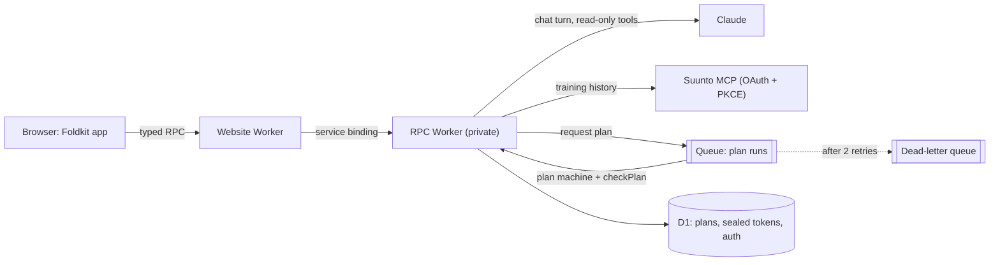

# An AI endurance coach that has to pass a 40-case eval gate before every deploy

**Live:** [ask: a public URL to cite, or a 60-second demo clip] · **Code:** private repo, code available on request · **Skills proven:** TypeScript, Effect, Cloudflare Workers, Cloudflare D1, Cloudflare Queues, Claude API, LLM evals, OAuth, XState, Foldkit, Alchemy, Vitest, Property-based testing, CI/CD

## The story

### Context

suunto-coach is an endurance-coaching web app. An athlete signs in with an email magic link and connects their own Suunto account through Suunto's official MCP server. A coach backed by Claude then chats with them, using typed UI blocks such as choice chips, a date picker, a number stepper and a goal card. It drafts a phased training plan from their real training history. Training data is private health data, so every store query is filtered by the signed-in athlete. [ask: why you built it and who it is for, in one sentence]

### My role and constraints

I built it alone, as a fork of Rat Stack: the strict TypeScript, lint and commit-hook floor came from Rat Stack, and the coach itself is mine. That covers the chat, the Suunto connection, plan drafting, sign-in, the infrastructure and the eval. Constraints:

- Suunto tokens are sealed with AES-256-GCM.
- The OAuth flow uses dynamic client registration and PKCE.
- The coach model may only call read-only capabilities.
- The eval runs on real Claude, so it costs money and needs a secret. That keeps it out of CI.

### Key decisions

1. **The server runs each chat turn over a typed transcript that the browser holds (ADR 0001).** The server rebuilds the prompt on every turn, so a tampered transcript cannot inject tool calls or tool results. A browser-driven tool loop and a Durable Object per conversation were both considered and rejected.
2. **The coach proposes; pure rules decide (ADR 0002).** Every draft passes `checkPlan` before it is stored. The rules check ramp rate, phase ramp, phase coverage, training days and week order. A rejected draft goes back to the model, up to a set number of attempts.
3. **Plan drafting runs on a Cloudflare Queue, not in the request (ADR 0003).** Drafting outlives a request. The queue runs a batch of 1 with 2 retries and a dead-letter queue, so no plan hangs in Pending. Workflows and a Durable Object per run were both considered and rejected.
4. **A topic-rule eval gates staging deploys (ADR 0005).** `pnpm eval:coach` sends 40 cases through the real chat turn on Claude: off-topic requests, jailbreaks, Polish-language cases and on-topic coaching. It checks `kind` and language exactly, and uses a small judge model only for the fuzzy cases. It exits 1 below 95%. A runtime classifier and a nightly CI eval were both considered and rejected.

ADRs: available on request with the code.

### What went wrong

The eval dropped to 37/40 on two of three runs, below the 95% gate (38/40). In the FAIL rows, a bad tool call from the coach ended the whole turn instead of being answered. I changed the tool runner so a failed tool call goes back to Claude as a result, and added a model test that generates out-of-range tool calls and fails if the old behaviour comes back. After the fix the eval passed 39/40 and 40/40.

### Result

The coach runs on a staging stage on Cloudflare: the Website Worker, a private RPC Worker, D1, Queues and email sign-in, all declared with Alchemy. The eval gate passes at 39/40 and 40/40, and every staging deploy has to clear it first. [ask: any users or outcome you can share]

## The evidence

- Architecture diagram:

- Tests and CI: about 350 test cases across the repo (some come with the Rat Stack base), including property tests on the plan rules, a model test of the plan state machine, 19 Foldkit scene tests and 3 browser end-to-end tests (one chats to a plan with real Claude). CI runs check, test and build on every push and pull request.
- Eval results: 40 cases, 95% gate. 37/40 before the fix, then 39/40 and 40/40.
- Screenshot or short clip: [ask: 60-second demo clip]
- What I'd do next: [ask: what you would do next]
