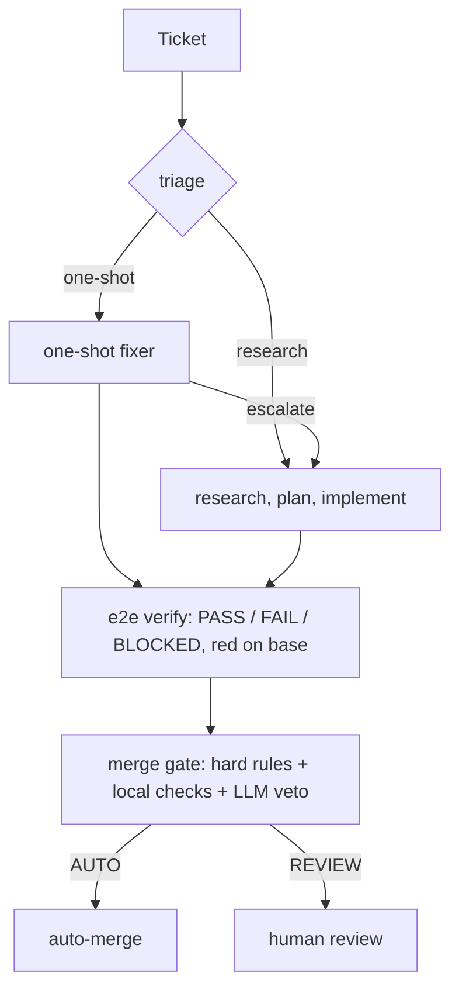

# A ticket-to-merge agent loop that auto-merged 23 PRs with 0 bad AUTO calls

**Live:** runs locally on a Mac mini, no public URL · **Code:** private (client work) · **Skills proven:** AI agents, Claude, LLM orchestration, Python, End-to-end testing, Merge gates, TypeScript, React

## The story

### Context

I work as a contractor on a client codebase, a React and TypeScript web app. Tickets wait in the client's tracker, and each one needs the same steps: read it, reproduce it, fix it, prove the fix, open a pull request, and wait for review. I built a loop that takes a ticket all the way to a merged pull request, or hands it to a human when it should not merge alone. This is how I'd work as a forward-deployed engineer: put agents into a real team's flow, with gates that the team can trust.

### My role and constraints

I designed, built and run the loop on my own. It runs locally on a Mac mini under launchd, with agent subprocesses for each stage. There is no cloud service behind it. Constraints:

- The client's Git host runs no pipeline on pull requests, so the loop's local checks are the CI.
- The loop never pushes to protected branches and never changes tickets.
- Anything that touches risky code goes to a human.

### Key decisions

1. **Triage first: one-shot or research.** A clear bug with an obvious fix in one module goes to a one-shot fixer. An ambiguous root cause, a design choice or a change across modules goes to a research → plan → implement worker. A one-shot fixer that finds the ticket harder than it looked escalates to research. Each role gets its own pinned model: a faster model for one-shot fixes and verification, a stronger one for research.
2. **Prove each fix with an end-to-end test that fails on the base.** A verify agent writes one small e2e test per acceptance criterion and runs it against the ticket branch, recording what was observed: live, mocked or static. It then runs the same test on a build of the merge-base. If the test does not fail there, it does not prove the fix.
3. **A three-layer merge gate.** The first layer is hard rules: deny paths such as auth, the API layer, dependencies and build config, plus local checks (lint with new warnings measured against the merge-base, related unit tests, a full type check, i18n extraction). The second is an LLM classifier that can only veto, never override a hard rule. The third is the decision itself: AUTO or REVIEW. The gate ran in shadow mode before auto-merge was switched on.
4. **Stop on a streak of failures.** A circuit breaker stops the loop after 3 bad tickets in a row, and the merge queue has a cap.

### What went wrong

The first version of the gate had hard rules for diff size, routes and retry counts. They sent good pull requests to review for reasons that said nothing about whether the change was correct. I compared the gate's calls with human review labels and removed those rules. The weight moved to verification evidence, and I loosened the classifier's risk threshold slightly after a reviewed case. [ask: a failure in your own words, if you want a different one]

### Result

101 tickets have gone through the loop. 23 were auto-merged, with 0 bad AUTO calls: no auto-merge was later changed or declined by a human. Everything else went to human review, or was stopped as blocked or skipped. [ask: any time-saved or throughput figure you have permission to share]

## The evidence

- Architecture diagram:

- Tests and CI: [ask: tests for the loop itself, if any]. The local checks in the gate stand in for CI on the client's pull requests.
- Eval results: the gate's AUTO and REVIEW calls were calibrated against human review labels. No AUTO call was overturned.
- Screenshot or short clip: [ask: an NDA-safe clip or screenshot of the loop, with client details removed]
- What I'd do next: [ask: what you would do next]
